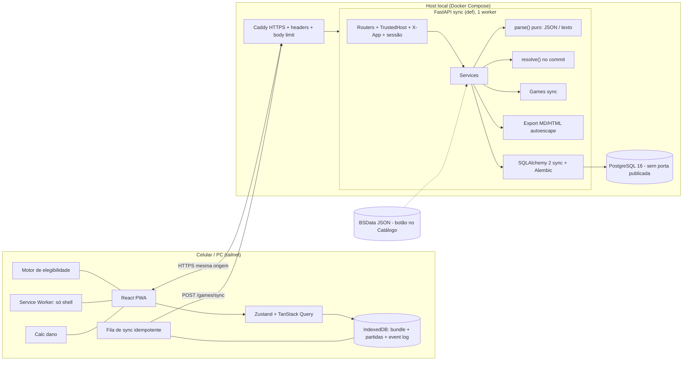
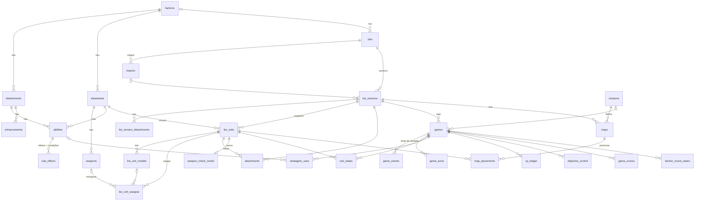

# SPEC — List Companion (WH40k) · PWA local

> Edital técnico. Uso local / privado, não comercial. Sem implementação neste documento.
> Dono do projeto · **Versão 0.3** · 2026-10-14 · Changelog no Apêndice A.
> Nome neutro "List Companion" (Warhammer/WH40k são marcas da GW; uso privado).

---

## 1. Visão e escopo

**Visão:** um **tracker de partida ao vivo**, para o usuário único não esquecer o que já fez e o que falta em cada fase. Ele importa a lista do New Recruit e, durante o jogo, mostra fase a fase:
- o que cada unidade ainda pode fazer e o que já fez (moveu, avançou, recuou, atirou, carregou, lutou, em ação/missão, Battle-shock, destruída);
- quais stratagems dá para usar agora e quanto CP sobra;
- os lembretes da facção (ex.: Shadow of Chaos).

O guia de turno passa a ter **estado**. Mapa, checagem de armas e diff vêm depois.

**MVP = importar → lista → guia → partida ao vivo offline** (fases 0–3):

| MVP (fases 0–3) | Depois (fases 4–6+) |
|---|---|
| Import do New Recruit: **JSON (principal)** + texto (fallback) | 4 — Checagem de armas (dano esperado no cliente) | Existe vários formas de exportar pelo New Recruit (.rosz, .ros, json, Yellow Scribe)
| Lista consolidada + quem lidera quem | 5 — Editor de mapa (deploy, objetivos, PNG/HTML) |
| Guia de turno (meu turno/oponente) + "Colar minha colinha" | 6 — Re-import, versões e diff; polish |
| **Partida ao vivo:** estado por unidade/turno, CP, stratagems com limites, objetivos, Shadow of Chaos, Battle-shock | v2 — keywords no cálculo (v2.1), Monte Carlo, multi-dispositivo, acesso público com auth |
| **Motor de elegibilidade** (regras como dados, roda no cliente e offline) | |
| Tudo offline no IndexedDB, sincroniza depois | |

**Facções:** começa por **Chaos Daemons**; schema multi-facção desde o início.

**Definição de pronto do MVP:**
1. Importar o export de Daemons e ver 1975 pts com os pares de líder corretos.
2. Jogar uma rodada offline marcando as ações; uma unidade que avançou fica cinza no Shooting.
3. Fechar e reabrir sem rede com o estado intacto; com rede, a partida sincroniza.

**Fora de escopo:**
- redistribuir texto da GW;
- scraping/import automático (Wahapedia, PDF de codex, app oficial, site/API do New Recruit). Exceção: o esqueleto do BSData, baixado por botão (ver Segurança → BSData);
- adjudicar regras (o motor **lembra e sinaliza**, nunca impede; sempre dá para sobrescrever);
- multiusuário, app nativo, hospedagem pública no MVP.

### 1.1 Concorrentes e diferencial

| Produto | O que faz bem | O que falta para este uso |
|---|---|---|
| **New Recruit** | Construtor de listas (dados BSData), export texto/JSON | Não acompanha a partida fase a fase |
| **App oficial 40k (GW)** | Regras e datasheets oficiais, construtor | Sem tracker por unidade/fase; fechado, sem import |
| **Wahapedia** | Referência de regras navegável | Só leitura; sem lista nem partida (sem scraping) |
| **Listforge** | Listas + ferramentas de jogo/torneio | Foco em torneio; sem regras pessoais nem elegibilidade por fase |

**Diferencial:** **export → tracker de fase ao vivo** com estado e elegibilidade por unidade, regras resumidas pelo próprio usuário, 100% offline na mesa. Depois, mapa e checagem de armas sobre a mesma lista. HIPÓTESE: o recorte dos concorrentes vem da pesquisa de 10/2026.

## 2. Personas e uso

- **Usuário único:** partidas casuais com amigos, no **Tabletop Simulator** (PC) e **na mesa** (celular, às vezes sem rede).
- Cenários:
  1. Exporta o JSON (ou copia o texto) do New Recruit → importa → revisa.
  2. Cola uma colinha antiga → o app sugere as fases → ele revisa.
  3. "Preparar pra mesa" baixa tudo pro celular.
  4. **Durante o jogo:** "Nova partida" → a cada fase, quem falta agir, quem não pode e por quê, stratagems disponíveis e CP. Um toque marca a ação.
  5. Fim do turno: lembrete de primária e secundárias; registro de objetivos e VP.

## 3. Requisitos funcionais

| ID | Requisito | Fase |
|---|---|---|
| RF01 | Importar **JSON do New Recruit** (roster BattleScribe) como principal; **texto** (Simple / WTC Compact / WTC Full) como fallback. Preview com avisos por linha ou caminho JSON. | 1 |
| RF02 | Extrair facção, detachment(s), force disposition, total, warlord, enhancements (+ portador), secundárias, unidades, modelos, wargear (com quantidade), pontos, líder/bodyguard. | 1 |
| RF03 | Consolidado com a soma comparada ao total declarado; pontos com estado abaixo/exato/acima. | 1 |
| RF04 | Pares líder → bodyguard: 1:1, mesma versão, exceção `allows_two_leaders`. | 1 |
| RF05 | `rule_effects` com resumo do usuário: fase, de quem é o turno, timing, dono, **condição/efeito de elegibilidade**. | 2 |
| RF06 | Guia: Command, **Battle-shock**, Movement, Shooting, Charge, Fight, Fim de turno; linha "efeito — Nome (Dono)"; toggle meu turno/oponente. | 2 |
| RF07 | Flag HIPÓTESE. | 2 |
| RF08 | "Colar minha colinha" (sem IA) → revisão → commit com ability escolhida; seed via `make seed` (Be'lakor). | 2 |
| RF09 | Export da colinha em Markdown. | 2 |
| RF10 | **Partida:** criar a partir de uma versão (snapshot), com oponente, missão (texto), quem começa e CP inicial. | 3 |
| RF11 | **Estado por unidade/turno:** movimento (`none/normal/advanced/fell_back/remained`), atirou, carregou, lutou, em ação/missão, Battle-shock, destruída. Um toque marca; desfazer. | 3 |
| RF12 | **Fases:** avançar CMD → BS → MOV → SHT → CHG → FGT → END e alternar o jogador; registra `game_turns`. | 3 |
| RF13 | **CP:** saldo, +1 na Command (editável), gastos, ajustes e histórico. | 3 |
| RF14 | **Stratagems:** os usáveis na fase atual; registrar o uso com CP; limites (1× por fase/turno/batalha) com aviso e override. | 3 |
| RF15 | **Objetivos:** controle por rodada (meu/oponente/contestado/ninguém); VP primária e secundárias. | 3 |
| RF16 | **Shadow of Chaos:** na Command, pergunta quantos objetivos controla e se o tabuleiro inteiro está em Shadow; registra e lista os efeitos dependentes (regra como dado; HIPÓTESE quanto ao texto da 11ª). | 3 |
| RF17 | **Battle-shock:** na Command, testa quem está em battle-shock **ou** na metade da força ou abaixo; passou → sai do battle-shock; falhou → continua ou entra. O estado **não** é limpo ao trocar de turno (Core 08.03). | 3 |
| RF18 | **Motor de elegibilidade** (cliente, offline): ativo/inativo/alerta por unidade e fase, com o motivo. Regras base + exceções de `rule_effects`. | 3 |
| RF19 | **Lembretes:** Movement destaca quem não moveu; Shooting/Charge acinzentam inelegíveis; Fight lista engajadas/carregaram; End lembra de missões, secundárias e ações. | 3 |
| RF20 | **Offline-first:** a partida vive no IndexedDB (event log); sync idempotente. | 3 |
| RF21 | Checagem de armas (cliente, "aproximado"); chip opcional se houver mais de um loadout. | 4 |
| RF22 | Editor de mapa; PNG (pixelRatio 2) / HTML. | 5 |
| RF23 | Re-import → nova versão; diff na leitura. | 6 |
| RF24 | Backup/restore JSON (confirmação, snapshot antes, `setval`). | 0 |

## 4. Requisitos não funcionais

- **Mobile-first:** 360px; alvos ≥48px; ações ao alcance do polegar; marcar em **1 toque**, desfazer em ≤2.
- **Offline:** partida, guia e lista funcionam sem rede depois de recarregar; resposta ao toque < 100 ms.
- **Durabilidade:** cada toque é persistido no IndexedDB antes da UI confirmar.
- **Desempenho:** parse < 300 ms (inclusive com input malicioso); elegibilidade de 30 unidades < 20 ms.
- **Idioma:** UI em PT-BR; fases, regras e unidades em inglês.
- **IP:** nenhum texto oficial; descrições de regras do JSON do NR **descartadas**.
- Sem telemetria.
- **Stack:** FastAPI + PostgreSQL 16 + Vite/React; SQLAlchemy 2 **sync** (rotas `def`); Alembic; Pydantic v2; TS.
- Wake Lock exige iOS 16.4+; sem suporte, chip de fallback.

## 5. Arquitetura



- **Mesma origem** (o Caddy serve o front e `/api`): sem `CORSMiddleware`.
- Motor e cálculo de dano só no cliente; o servidor guarda dados e eventos.
- **SW** com precache só do shell; `/api/*` é `NetworkOnly`; o offline vem **só** do IndexedDB.

### 5.1 Import do New Recruit

**Pesquisa:** o export de texto do NR **não tem spec pública** e tem vários formatos (**Simple**, **WTC Compact**, **WTC Full**) que mudam. Por isso o **JSON** (roster BattleScribe) é o principal e o texto é fallback tolerante, ambos com fixtures reais.

**Separação:**
- `parse(input) -> ParseResult`: **puro**, determinístico, sem banco (usado pelo `/imports/parse`).
- `resolve(ParseResult, catálogo, resolutions)`: só no commit.
- O `POST /imports` **não confia no preview**: reparseia o `raw_text` e compara o `parse_hash` (sha256 de `parser_version` + entrada normalizada); se divergir, **409 `parse_changed`**. As escolhas referenciam o **número da linha** ou o **caminho JSON**.

**Limites:** ≤200 KB no Caddy; na API, normalizar (NFKC; remover `\x00` e controle, menos `\n`/`\t`) **e depois** validar `len(utf8) ≤ 204800` → 413. O CHECK do banco é só rede de segurança.

#### 5.1.a JSON (principal)

- Estrutura esperada (**HIPÓTESE até a 1ª fixture**): `roster.costs[]`, `roster.forces[] → selections[]` recursivo. Cada selection tem `name`, `type` (`unit/model/upgrade`), `number`, `costs[]`, `categories[]`, `profiles[]`, `rules[]` e `selections[]`.
- Limites: profundidade ≤20, ≤5.000 nós, strings ≤500 chars (truncar + warning com `json_path`); `json.loads` sem hooks.
- Mapeamento:
  - detachment, disposition e enhancement vêm de `upgrade` por grupo/categoria;
  - warlord vem da categoria `Warlord`;
  - pontos somam `costs[pts]` da subárvore;
  - wargear são as `upgrade` filhas de `model`;
  - líder vem da categoria/campo de attachment; senão, o usuário pareia no preview.
- **IP:** de `profiles[]` entram os **números** da ficha (M, T, Sv, W, Ld, OC, InSv, base), o nome das habilidades e as keywords de arma. **`description` e o texto da habilidade são descartados.** Feel No Pain entra só pelo número no nome da rule (`Feel No Pain N+`). Icone e instrumento entram como wargear sem perfil.

#### 5.1.b Texto (fallback)

Exemplo (Simple, real, abreviado):

```
+++++++++++++++++++++++++++++++++++++++++++++++
+ FACTION KEYWORD: Chaos - Chaos Daemons
+ DETACHMENT: Daemonic Incursion (Warp Rifts)
+ FORCE DISPOSITION: Disruption
+ TOTAL ARMY POINTS: 1975pts
+
+ WARLORD: Char1: Shalaxi Helbane
+ ENHANCEMENT: The Endless Gift (on Char2: Great Unclean One)
+ NUMBER OF UNITS: 12
+ SECONDARY: - Bring It Down: (2x2) + (1x4) + (2x6) - Assassination: 4 Characters
+++++++++++++++++++++++++++++++++++++++++++++++

Char2: 1x Great Unclean One (295 pts): Putrid vomit, Bilesword, Plague flail
Enhancement: The Endless Gift (+30 pts)
Char4: 1x Poxbringer (60 pts): Foul balesword
Leading Plaguebearers[1]

10x Plaguebearers (115 pts)
• 9x Plaguebearer
    7 with Plaguesword
    1 with Instrument of Chaos, Plaguesword
• 1x Plagueridden: Plaguesword
  Attached to Poxbringer

Created with newrecruit.eu v36.47
```

**Detecção de formato:** pela assinatura (`+++` = Simple; marcadores WTC = Compact/Full), com um sub-parser por formato. Desconhecido → melhor esforço + `unknown_format`.

Máquina de estados (`TOP`, `UNIT`, `MODEL_GROUP`), com warnings `{line_no, text, reason}`:

1. ≤5.000 linhas; uma linha com mais de 500 chars vira `truncated` e **não passa pelas regex**.
2. CRLF → LF; NBSP → espaço; marcadores → `•`. **Não aparar a indentação**; o estado decide se é sub-loadout.
3. Persistir `raw_text`, `input_format`, `parser_version`, `generator`, `parse_hash`.
4. **Cabeçalho** `^\+\s*([A-Z][A-Z ]{0,40}):\s*(.{0,450})$`:
   - `DETACHMENT` repetido = vários; o sufixo `(...)` vira `variant`; a vírgula só separa se cada parte casar com um detachment conhecido.
   - `SECONDARY` dividido por `' - '`.
   - Inteiros `\d{1,6}` com teto.
   - `WARLORD`/`ENHANCEMENT` ligados pelo `CharN` **e** pelo nome; divergência vira warning, e o corpo vence.
   - Sem facção → `faction_missing`; o commit exige escolher (nunca 500).
5. **Corpo:**
   - unidade (âncora no **último** `(N pts)`): `^(?:(Char\d{1,3}):\s*)?(\d{1,4})x\s+(.{1,200}?)\s*\((\d{1,6})\s*pts?\)(?::\s*(.{0,400}))?$`
   - `^Enhancement:\s*(.{1,200}?)\s*\(\+(\d{1,4})\s*pts?\)$`
   - `^Leading\s+(.{1,200}?)(?:\[(\d{1,3})\])?$`
   - `^•\s*(\d{1,4})x\s+([^:]{1,200})(?::\s*(.{0,400}))?$` → `MODEL_GROUP`
   - `^\s*(\d{1,4})\s+with\s+(.{1,400})$` só em `MODEL_GROUP`
   - `^\s*Attached to\s+(.{1,200})$` **fecha o `MODEL_GROUP`** e vale para a unidade.
   - Wargear separado por `, `; `2x Nome` → `count`; item que não casar vira warning.
6. **Enhancement nas duas somas:**
   - sem enhancement ou com 0 pts → "incluído", sem warning;
   - com um: incluído vs soma + N;
   - com vários: "todos" vs "nenhum"; uma combinação mista ou nenhuma → warning com as somas.
   - Grava `points_include_enhancement`.
7. **Líderes (1:1):** `Leading X[n]` aponta para a n-ésima unidade X (**HIPÓTESE:** de 1 em diante, na ordem do export; fixture no golden). `Attached to Y` aponta para o líder pelo nome. Casa pelo `[n]` primeiro, depois pelo líder sem par. Ambiguidade → nada automático, a escolha vai para o preview. Só um lado → aceita com warning.

**Commit:** transação com `SELECT … FROM lists … FOR UPDATE` → `version_no = max+1` → **sempre resolver por nome** facção, detachment, datasheet e enhancement (stub ≤100). Toda unidade sai com `datasheet_id` → atualiza `current_version_id`.

**Fixtures (só nomes e pontos):**
- JSON: Daemons, multi-detachment.
- Texto: Daemons Simple (1975, Poxbringer ↔ Plaguebearers[1]), AdMech, multi-detachment, WTC Compact, WTC Full, nome com parênteses, duas unidades iguais com `[n]`, dois enhancements.

### 5.2 "Colar minha colinha" (sem IA)

- Fase por cabeçalho (EN/PT) ou palavra-chave; o sufixo `(X)` vira `owner_label`.
- Na revisão, cada linha recebe um dono:
  - "Geral" → `general`;
  - unidade → `unit` no `datasheet_id` dela;
  - detachment → `detachment`;
  - sem par → `general` com `name = owner_label`.
- O UNIQUE de `abilities` evita duplicar.
- Seed do Be'lakor: arquivo local fora do git, `make seed` idempotente, **nunca migration**.

### 5.3 Efeitos de uma versão

Efeitos(V) =
- `core` + `general`
- \+ `faction` (`lists.faction_id`)
- \+ `detachment`/`stratagem`/`enhancement` (`list_version_detachments`, `list_units.enhancement_id`)
- \+ `unit`/`leader` (`list_units.datasheet_id`)

Cada ability é ligada aos seus `rule_effects`. Isso alimenta o `/turn-guide`, o `/bundle` e o motor.

### 5.4 Motor de elegibilidade (cliente)

**Princípio:** regras como dados, avaliadas sem interpretar texto. **Sinaliza, não bloqueia**; o override fica registrado no evento.

**Entradas:** fase, de quem é o turno, `unit_state` do turno, keywords da unidade e das armas, attachments, estado da partida (Shadow, CP, `stratagem_uses`), `rule_effects` (`effect_kind` + `condition_json`).

**Regras base** (seed `core`, resumo próprio, HIPÓTESE até conferir):

| Fase | Inativa se | Exceção (`allow`) |
|---|---|---|
| Movement | já moveu; destruída | — |
| Shooting | `advanced` | `ASSAULT` (só armas ASSAULT ativas) |
| Shooting | `fell_back` | regra que permite atirar após recuar |
| Shooting | `on_action` | regra da ação |
| Shooting | já atirou; engajada: CLOSE-QUARTERS ou PISTOL (PISTOL conta como CLOSE-QUARTERS), sem BLAST no alvo engajado; MONSTER/VEHICLE ainda atiram normalmente; aviso de −1 para acertar | — |
| Charge | `advanced` ou `fell_back` | regra que permite carregar |
| Charge | `on_action`; já carregou | — |
| Fight | não engajada e não carregou; já lutou | lutar de novo |
| Qualquer | `destroyed` | — |
| Battle-shock | `battle_shocked` → avisa que o OC vira traço, a unidade não pode ser alvo de stratagem e não começa nem conclui ação | — |

**`condition_json`** (schema fechado, Pydantic + cliente):

```json
{ "all": [ {"phase": "shooting"}, {"state.moved": "advanced"}, {"weapon_keyword": "ASSAULT"} ] }
```

- Operadores `all`/`any`/`not`.
- Fatos: `phase`, `turn_owner`, `state.<campo>`, `unit_keyword`, `weapon_keyword`, `is_leading`, `game.shadow_of_chaos`, `game.round`.
- Profundidade ≤5; ≤20 nós.

**`effect_kind`:** `reminder`, `allow` (anula uma `restriction_key`), `deny`, `prompt` (ex.: Shadow of Chaos), `stratagem`.

**Saída:** `{status: active|inactive|done|warn, reasons[], allowed_weapons[]}`, com as razões em PT-BR.

### 5.5 Partida offline e sync

- **Event-sourced no cliente:** cada toque gera um `game_event {id: uuid, game_id, seq, device_id, type, payload, created_at}`; o estado é derivado e materializado no IndexedDB.
- Tipos: `game_started` (com cópia dos pares de líder), `phase_advanced`, `unit_state_set`, `cp_changed`, `stratagem_used`, `objective_set`, `vp_scored`, `shadow_set`, `battleshock_result`, `undo`, `game_ended`.
- **Sync:** `POST /games/sync` → `ON CONFLICT (id) DO NOTHING`, recalcula as projeções na transação, devolve `last_seq`. Single-user: `seq` duplicado de outro `device_id` é ordenado por `created_at` e depois `device_id`, com aviso.
- A partida guarda `list_version_id` + `bundle_etag`; o snapshot é imutável.

## 6. Modelo de dados (PostgreSQL 16)

**Convenções:**
- `BIGSERIAL` no catálogo e nas listas; **UUID** nas tabelas de partida.
- `created_at/updated_at` em todas as tabelas mutáveis, com o trigger `set_updated_at()`.
- Enums como `TEXT CHECK`.
- **Índice em toda FK**.
- `naming_convention` do Alembic.

### 6.1 Catálogo

```sql
CREATE TABLE factions (
  id BIGSERIAL PRIMARY KEY,
  name TEXT NOT NULL UNIQUE CHECK (length(name) <= 200),
  short_name TEXT,
  accent_color CHAR(7) NOT NULL DEFAULT '#8A8A8A' CHECK (accent_color ~ '^#[0-9A-Fa-f]{6}$'),
  source TEXT NOT NULL DEFAULT 'user' CHECK (source IN ('user','import','bsdata')),
  source_ref TEXT,
  created_at TIMESTAMPTZ NOT NULL DEFAULT now(), updated_at TIMESTAMPTZ NOT NULL DEFAULT now()
);

CREATE TABLE detachments (
  id BIGSERIAL PRIMARY KEY,
  faction_id BIGINT NOT NULL REFERENCES factions(id) ON DELETE CASCADE,
  name TEXT NOT NULL, variant TEXT, notes TEXT,
  created_at TIMESTAMPTZ NOT NULL DEFAULT now(), updated_at TIMESTAMPTZ NOT NULL DEFAULT now(),
  UNIQUE NULLS NOT DISTINCT (faction_id, name, variant)
);

CREATE TABLE datasheets (
  id BIGSERIAL PRIMARY KEY,
  faction_id BIGINT NOT NULL REFERENCES factions(id) ON DELETE CASCADE,
  name TEXT NOT NULL,
  movement SMALLINT,
  toughness SMALLINT CHECK (toughness >= 1),
  save SMALLINT CHECK (save BETWEEN 2 AND 6),
  invuln SMALLINT CHECK (invuln BETWEEN 2 AND 6),
  wounds SMALLINT CHECK (wounds >= 1),
  leadership SMALLINT, oc SMALLINT,
  fnp SMALLINT CHECK (fnp BETWEEN 2 AND 6),
  keywords TEXT[] NOT NULL DEFAULT '{}' CHECK (cardinality(keywords) <= 50),
  base_size_mm TEXT,
  is_character BOOLEAN NOT NULL DEFAULT false,
  allows_two_leaders BOOLEAN NOT NULL DEFAULT false,
  is_stub BOOLEAN NOT NULL DEFAULT true,
  source TEXT NOT NULL DEFAULT 'user', source_ref TEXT,
  created_at TIMESTAMPTZ NOT NULL DEFAULT now(), updated_at TIMESTAMPTZ NOT NULL DEFAULT now(),
  UNIQUE (faction_id, name)
);

CREATE TABLE weapons (
  id BIGSERIAL PRIMARY KEY,
  datasheet_id BIGINT REFERENCES datasheets(id) ON DELETE CASCADE,
  name TEXT NOT NULL,
  kind TEXT NOT NULL DEFAULT 'unknown' CHECK (kind IN ('ranged','melee','wargear','unknown')),
  range_in SMALLINT,
  attacks TEXT CHECK (attacks ~ '^(\d{1,2}|D3|D6|\d?D[36](\+\d{1,2})?)$'),
  skill SMALLINT CHECK (skill BETWEEN 2 AND 6),
  strength SMALLINT CHECK (strength >= 1),
  ap SMALLINT CHECK (ap BETWEEN -6 AND 0),
  damage TEXT CHECK (damage ~ '^(\d{1,2}|D3|D6|\d?D[36](\+\d{1,2})?)$'),
  keywords TEXT[] NOT NULL DEFAULT '{}' CHECK (cardinality(keywords) <= 50),
  is_stub BOOLEAN NOT NULL DEFAULT true,
  created_at TIMESTAMPTZ NOT NULL DEFAULT now(), updated_at TIMESTAMPTZ NOT NULL DEFAULT now(),
  UNIQUE NULLS NOT DISTINCT (datasheet_id, name)
);
CREATE INDEX ix_weapons_datasheet_id ON weapons (datasheet_id);

CREATE TABLE abilities (
  id BIGSERIAL PRIMARY KEY,
  kind TEXT NOT NULL CHECK (kind IN ('core','faction','detachment','unit','leader','stratagem','enhancement','general')),
  faction_id BIGINT REFERENCES factions(id) ON DELETE CASCADE,
  datasheet_id BIGINT REFERENCES datasheets(id) ON DELETE CASCADE,
  detachment_id BIGINT REFERENCES detachments(id) ON DELETE CASCADE,
  name TEXT NOT NULL CHECK (length(name) <= 200),
  cp_cost SMALLINT CHECK (cp_cost BETWEEN 0 AND 5),
  use_limit TEXT CHECK (use_limit IN ('per_phase','per_turn','per_round','per_battle','none')),
  usable_turn TEXT CHECK (usable_turn IN ('own','opponent','either')),
  summary_user TEXT CHECK (length(summary_user) <= 4000),
  is_hypothesis BOOLEAN NOT NULL DEFAULT false,
  created_at TIMESTAMPTZ NOT NULL DEFAULT now(), updated_at TIMESTAMPTZ NOT NULL DEFAULT now(),
  UNIQUE NULLS NOT DISTINCT (kind, faction_id, datasheet_id, detachment_id, name),
  CHECK (num_nonnulls(faction_id, datasheet_id, detachment_id) <= 1),
  CHECK (
    (kind IN ('core','general') AND num_nonnulls(faction_id, datasheet_id, detachment_id) = 0) OR
    (kind = 'faction' AND faction_id IS NOT NULL) OR
    (kind IN ('unit','leader') AND datasheet_id IS NOT NULL) OR
    (kind IN ('detachment','stratagem','enhancement') AND detachment_id IS NOT NULL)
  )
);
CREATE INDEX ix_abilities_faction_id ON abilities (faction_id);
CREATE INDEX ix_abilities_datasheet_id ON abilities (datasheet_id);
CREATE INDEX ix_abilities_detachment_id ON abilities (detachment_id);

CREATE TABLE enhancements (
  id BIGSERIAL PRIMARY KEY,
  detachment_id BIGINT REFERENCES detachments(id) ON DELETE CASCADE,
  name TEXT NOT NULL, points SMALLINT CHECK (points >= 0), restrictions TEXT,
  ability_id BIGINT REFERENCES abilities(id) ON DELETE SET NULL,
  created_at TIMESTAMPTZ NOT NULL DEFAULT now(), updated_at TIMESTAMPTZ NOT NULL DEFAULT now(),
  UNIQUE NULLS NOT DISTINCT (detachment_id, name)
);
CREATE INDEX ix_enhancements_ability_id ON enhancements (ability_id);

CREATE TABLE rule_effects (
  id BIGSERIAL PRIMARY KEY,
  ability_id BIGINT NOT NULL REFERENCES abilities(id) ON DELETE CASCADE,
  phase TEXT NOT NULL CHECK (phase IN ('deployment','command','battle_shock','movement','shooting','charge','fight','end_of_turn','any')),
  turn_owner TEXT NOT NULL DEFAULT 'own' CHECK (turn_owner IN ('own','opponent','both')),
  timing TEXT NOT NULL DEFAULT 'during' CHECK (timing IN ('start','during','end')),
  effect_kind TEXT NOT NULL DEFAULT 'reminder' CHECK (effect_kind IN ('reminder','allow','deny','prompt','stratagem')),
  restriction_key TEXT CHECK (restriction_key IN ('shoot_after_advance','shoot_after_fall_back','charge_after_advance','charge_after_fall_back','shoot_on_action','shoot_engaged','fight_again')),
  condition_json JSONB NOT NULL DEFAULT '{}',
  owner_label TEXT NOT NULL CHECK (length(owner_label) <= 200),
  effect_text TEXT NOT NULL CHECK (length(effect_text) <= 4000),
  range_in SMALLINT,
  sort_order SMALLINT NOT NULL DEFAULT 0,
  is_hypothesis BOOLEAN NOT NULL DEFAULT false,
  created_at TIMESTAMPTZ NOT NULL DEFAULT now(), updated_at TIMESTAMPTZ NOT NULL DEFAULT now(),
  CHECK (effect_kind NOT IN ('allow','deny') OR restriction_key IS NOT NULL)
);
CREATE INDEX ix_rule_effects_ability_id ON rule_effects (ability_id);

CREATE TABLE target_profiles (
  id BIGSERIAL PRIMARY KEY,
  name TEXT NOT NULL UNIQUE,
  toughness SMALLINT NOT NULL CHECK (toughness >= 1),
  save SMALLINT NOT NULL CHECK (save BETWEEN 2 AND 6),
  invuln SMALLINT CHECK (invuln BETWEEN 2 AND 6),
  wounds SMALLINT NOT NULL CHECK (wounds >= 1),
  fnp SMALLINT CHECK (fnp BETWEEN 2 AND 6),
  models SMALLINT NOT NULL DEFAULT 1 CHECK (models >= 1),
  keywords TEXT[] NOT NULL DEFAULT '{}',
  created_at TIMESTAMPTZ NOT NULL DEFAULT now(), updated_at TIMESTAMPTZ NOT NULL DEFAULT now()
);
```

### 6.2 Listas, imports, versões e sessões

```sql
CREATE TABLE lists (
  id BIGSERIAL PRIMARY KEY,
  name TEXT NOT NULL,
  faction_id BIGINT REFERENCES factions(id),
  current_version_id BIGINT,
  archived BOOLEAN NOT NULL DEFAULT false,
  created_at TIMESTAMPTZ NOT NULL DEFAULT now(), updated_at TIMESTAMPTZ NOT NULL DEFAULT now()
);
CREATE INDEX ix_lists_faction_id ON lists (faction_id);

CREATE TABLE imports (
  id BIGSERIAL PRIMARY KEY,
  list_id BIGINT NOT NULL REFERENCES lists(id) ON DELETE CASCADE,
  raw_text TEXT NOT NULL CHECK (octet_length(raw_text) <= 204800),
  input_format TEXT NOT NULL CHECK (input_format IN ('nr_json','nr_text_simple','nr_text_wtc_compact','nr_text_wtc_full','nr_text_unknown')),
  parser_version TEXT NOT NULL,
  parse_hash CHAR(64) NOT NULL,
  generator TEXT,
  parsed_json JSONB NOT NULL,
  warnings JSONB NOT NULL DEFAULT '[]',
  created_at TIMESTAMPTZ NOT NULL DEFAULT now()
);
CREATE INDEX ix_imports_list_id ON imports (list_id);

CREATE TABLE list_versions (
  id BIGSERIAL PRIMARY KEY,
  list_id BIGINT NOT NULL REFERENCES lists(id) ON DELETE CASCADE,
  version_no INT NOT NULL,
  import_id BIGINT REFERENCES imports(id) ON DELETE SET NULL,
  label TEXT,
  faction_name TEXT NOT NULL,
  detachment_names TEXT[] NOT NULL DEFAULT '{}',
  force_disposition TEXT,
  secondaries TEXT[] NOT NULL DEFAULT '{}',
  total_points_declared INT CHECK (total_points_declared BETWEEN 0 AND 100000),
  points_include_enhancement BOOLEAN,
  created_at TIMESTAMPTZ NOT NULL DEFAULT now(), updated_at TIMESTAMPTZ NOT NULL DEFAULT now(),
  UNIQUE (list_id, version_no),
  UNIQUE (id, list_id)
);
CREATE INDEX ix_list_versions_list_id ON list_versions (list_id);
CREATE INDEX ix_list_versions_import_id ON list_versions (import_id);

ALTER TABLE lists ADD CONSTRAINT fk_lists_current_version
  FOREIGN KEY (current_version_id, id) REFERENCES list_versions (id, list_id)
  DEFERRABLE INITIALLY DEFERRED;

CREATE TABLE list_version_detachments (
  list_version_id BIGINT REFERENCES list_versions(id) ON DELETE CASCADE,
  detachment_id BIGINT REFERENCES detachments(id),
  PRIMARY KEY (list_version_id, detachment_id)
);
CREATE INDEX ix_lvd_detachment_id ON list_version_detachments (detachment_id);

CREATE TABLE list_units (
  id BIGSERIAL PRIMARY KEY,
  list_version_id BIGINT NOT NULL REFERENCES list_versions(id) ON DELETE CASCADE,
  datasheet_name TEXT NOT NULL,
  datasheet_id BIGINT NOT NULL REFERENCES datasheets(id),
  export_ref TEXT,
  model_count SMALLINT NOT NULL CHECK (model_count BETWEEN 1 AND 200),
  points INT NOT NULL CHECK (points BETWEEN 0 AND 10000),
  enhancement_name TEXT, enhancement_points SMALLINT,
  enhancement_id BIGINT REFERENCES enhancements(id) ON DELETE SET NULL,
  is_warlord BOOLEAN NOT NULL DEFAULT false,
  sort_order SMALLINT NOT NULL DEFAULT 0,
  created_at TIMESTAMPTZ NOT NULL DEFAULT now(),
  UNIQUE (id, list_version_id)
);
CREATE INDEX ix_list_units_list_version_id ON list_units (list_version_id);
CREATE INDEX ix_list_units_datasheet_id ON list_units (datasheet_id);
CREATE INDEX ix_list_units_enhancement_id ON list_units (enhancement_id);
CREATE UNIQUE INDEX uq_list_units_one_warlord ON list_units (list_version_id) WHERE is_warlord;
CREATE UNIQUE INDEX uq_list_units_export_ref ON list_units (list_version_id, export_ref) WHERE export_ref IS NOT NULL;

CREATE TABLE list_unit_models (
  id BIGSERIAL PRIMARY KEY,
  list_unit_id BIGINT NOT NULL REFERENCES list_units(id) ON DELETE CASCADE,
  model_name TEXT NOT NULL,
  count SMALLINT NOT NULL CHECK (count BETWEEN 1 AND 200),
  UNIQUE (id, list_unit_id)
);
CREATE INDEX ix_list_unit_models_list_unit_id ON list_unit_models (list_unit_id);

CREATE TABLE list_unit_wargear (
  id BIGSERIAL PRIMARY KEY,
  list_unit_id BIGINT NOT NULL REFERENCES list_units(id) ON DELETE CASCADE,
  list_unit_model_id BIGINT,
  weapon_name TEXT NOT NULL,
  weapon_id BIGINT REFERENCES weapons(id) ON DELETE SET NULL,
  count SMALLINT NOT NULL DEFAULT 1 CHECK (count >= 1),
  FOREIGN KEY (list_unit_model_id, list_unit_id) REFERENCES list_unit_models (id, list_unit_id) ON DELETE CASCADE
);
CREATE INDEX ix_luw_list_unit_id ON list_unit_wargear (list_unit_id);
CREATE INDEX ix_luw_model ON list_unit_wargear (list_unit_model_id, list_unit_id);
CREATE INDEX ix_luw_weapon_id ON list_unit_wargear (weapon_id);

CREATE TABLE attachments (
  id BIGSERIAL PRIMARY KEY,
  list_version_id BIGINT NOT NULL REFERENCES list_versions(id) ON DELETE CASCADE,
  leader_list_unit_id BIGINT NOT NULL,
  bodyguard_list_unit_id BIGINT NOT NULL,
  source TEXT NOT NULL DEFAULT 'import' CHECK (source IN ('import','user')),
  created_at TIMESTAMPTZ NOT NULL DEFAULT now(), updated_at TIMESTAMPTZ NOT NULL DEFAULT now(),
  UNIQUE (leader_list_unit_id),
  FOREIGN KEY (leader_list_unit_id, list_version_id)    REFERENCES list_units (id, list_version_id) ON DELETE CASCADE,
  FOREIGN KEY (bodyguard_list_unit_id, list_version_id) REFERENCES list_units (id, list_version_id) ON DELETE CASCADE,
  CHECK (leader_list_unit_id <> bodyguard_list_unit_id)
);
CREATE INDEX ix_attachments_list_version_id ON attachments (list_version_id);
CREATE INDEX ix_attachments_bodyguard ON attachments (bodyguard_list_unit_id);

CREATE TABLE weapon_check_marks (
  list_unit_id BIGINT PRIMARY KEY REFERENCES list_units(id) ON DELETE CASCADE,
  checked_at TIMESTAMPTZ NOT NULL DEFAULT now(),
  chosen_loadout_label TEXT
);

CREATE TABLE sessions (
  id BIGSERIAL PRIMARY KEY,
  token_hash CHAR(64) NOT NULL UNIQUE,
  user_agent TEXT CHECK (length(user_agent) <= 300),
  created_at TIMESTAMPTZ NOT NULL DEFAULT now(),
  last_seen_at TIMESTAMPTZ NOT NULL DEFAULT now(),
  expires_at TIMESTAMPTZ NOT NULL
);
CREATE INDEX ix_sessions_expires_at ON sessions (expires_at);
```

**Imutabilidade:** depois do commit, o snapshot (unidades, modelos, wargear, pontos, campos de `list_versions`) é imutável (409 `version_immutable`). Só mudam `attachments` (`source='user'`, em qualquer versão; a partida guarda a própria cópia no `game_started`), `label` e `weapon_check_marks`. Sem `version_diffs` e sem número de dano guardado.

### 6.3 Partidas (fase 3; UUID; projeções dos eventos)

```sql
CREATE TABLE games (
  id UUID PRIMARY KEY,
  list_version_id BIGINT NOT NULL REFERENCES list_versions(id),
  bundle_etag TEXT NOT NULL,
  opponent_name TEXT CHECK (length(opponent_name) <= 200),
  opponent_faction TEXT CHECK (length(opponent_faction) <= 200),
  mission_name TEXT CHECK (length(mission_name) <= 200),
  mission_id BIGINT,
  first_player TEXT NOT NULL CHECK (first_player IN ('me','opponent')),
  status TEXT NOT NULL DEFAULT 'active' CHECK (status IN ('active','finished','abandoned')),
  current_round SMALLINT NOT NULL DEFAULT 1 CHECK (current_round BETWEEN 1 AND 10),
  current_player TEXT NOT NULL CHECK (current_player IN ('me','opponent')),
  current_phase TEXT NOT NULL DEFAULT 'command' CHECK (current_phase IN ('command','battle_shock','movement','shooting','charge','fight','end_of_turn')),
  cp_me SMALLINT NOT NULL DEFAULT 0 CHECK (cp_me BETWEEN 0 AND 99),
  cp_opponent SMALLINT CHECK (cp_opponent BETWEEN 0 AND 99),
  vp_me SMALLINT NOT NULL DEFAULT 0, vp_opponent SMALLINT NOT NULL DEFAULT 0,
  last_seq INT NOT NULL DEFAULT 0,
  created_at TIMESTAMPTZ NOT NULL DEFAULT now(), updated_at TIMESTAMPTZ NOT NULL DEFAULT now(),
  UNIQUE (id, list_version_id)
);
CREATE INDEX ix_games_list_version_id ON games (list_version_id);
CREATE INDEX ix_games_mission_id ON games (mission_id);

CREATE TABLE game_events (
  id UUID PRIMARY KEY,
  game_id UUID NOT NULL REFERENCES games(id) ON DELETE CASCADE,
  seq INT NOT NULL CHECK (seq >= 1),
  device_id TEXT NOT NULL CHECK (length(device_id) <= 64),
  type TEXT NOT NULL CHECK (type IN ('game_started','phase_advanced','unit_state_set','cp_changed','stratagem_used','objective_set','vp_scored','shadow_set','battleshock_result','undo','game_ended')),
  payload JSONB NOT NULL CHECK (octet_length(payload::text) <= 8192),
  undoes_event_id UUID REFERENCES game_events(id),
  created_at TIMESTAMPTZ NOT NULL,
  received_at TIMESTAMPTZ NOT NULL DEFAULT now(),
  UNIQUE (game_id, device_id, seq)
);
CREATE INDEX ix_game_events_game_seq ON game_events (game_id, seq);
CREATE INDEX ix_game_events_undoes ON game_events (undoes_event_id);

CREATE TABLE game_turns (
  id UUID PRIMARY KEY,
  game_id UUID NOT NULL REFERENCES games(id) ON DELETE CASCADE,
  round SMALLINT NOT NULL CHECK (round BETWEEN 1 AND 10),
  player TEXT NOT NULL CHECK (player IN ('me','opponent')),
  phase TEXT NOT NULL CHECK (phase IN ('command','battle_shock','movement','shooting','charge','fight','end_of_turn')),
  started_at TIMESTAMPTZ NOT NULL, ended_at TIMESTAMPTZ,
  UNIQUE (game_id, round, player, phase)
);

CREATE TABLE unit_states (
  id UUID PRIMARY KEY,
  game_id UUID NOT NULL,
  list_version_id BIGINT NOT NULL,
  list_unit_id BIGINT NOT NULL,
  round SMALLINT NOT NULL CHECK (round BETWEEN 1 AND 10),
  player TEXT NOT NULL CHECK (player IN ('me','opponent')),
  moved TEXT NOT NULL DEFAULT 'none' CHECK (moved IN ('none','normal','advanced','fell_back','remained')),
  shot BOOLEAN NOT NULL DEFAULT false,
  charged BOOLEAN NOT NULL DEFAULT false,
  fought BOOLEAN NOT NULL DEFAULT false,
  engaged BOOLEAN NOT NULL DEFAULT false,
  on_action BOOLEAN NOT NULL DEFAULT false,
  action_name TEXT CHECK (length(action_name) <= 200),
  battle_shocked BOOLEAN NOT NULL DEFAULT false,
  below_half BOOLEAN NOT NULL DEFAULT false,
  destroyed BOOLEAN NOT NULL DEFAULT false,
  in_reserves BOOLEAN NOT NULL DEFAULT false,
  overrides JSONB NOT NULL DEFAULT '[]',
  updated_at TIMESTAMPTZ NOT NULL DEFAULT now(),
  UNIQUE (game_id, list_unit_id, round, player),
  FOREIGN KEY (game_id, list_version_id)      REFERENCES games (id, list_version_id) ON DELETE CASCADE,
  FOREIGN KEY (list_unit_id, list_version_id) REFERENCES list_units (id, list_version_id)
);
CREATE INDEX ix_unit_states_game ON unit_states (game_id, list_version_id);
CREATE INDEX ix_unit_states_unit ON unit_states (list_unit_id, list_version_id);

CREATE TABLE stratagem_uses (
  id UUID PRIMARY KEY,
  game_id UUID NOT NULL REFERENCES games(id) ON DELETE CASCADE,
  ability_id BIGINT REFERENCES abilities(id) ON DELETE SET NULL,
  stratagem_name TEXT NOT NULL,
  round SMALLINT NOT NULL, player TEXT NOT NULL CHECK (player IN ('me','opponent')),
  phase TEXT NOT NULL,
  cp_spent SMALLINT NOT NULL CHECK (cp_spent BETWEEN 0 AND 5),
  target_list_unit_id BIGINT REFERENCES list_units(id),
  limit_overridden BOOLEAN NOT NULL DEFAULT false,
  created_at TIMESTAMPTZ NOT NULL
);
CREATE INDEX ix_strat_uses_game ON stratagem_uses (game_id, round, player, phase);
CREATE INDEX ix_strat_uses_ability ON stratagem_uses (ability_id);
CREATE INDEX ix_strat_uses_target ON stratagem_uses (target_list_unit_id);

CREATE TABLE cp_ledger (
  id UUID PRIMARY KEY,
  game_id UUID NOT NULL REFERENCES games(id) ON DELETE CASCADE,
  round SMALLINT NOT NULL, player TEXT NOT NULL CHECK (player IN ('me','opponent')),
  phase TEXT NOT NULL,
  delta SMALLINT NOT NULL CHECK (delta BETWEEN -10 AND 10),
  reason TEXT NOT NULL CHECK (reason IN ('command_phase','stratagem','ability','manual')),
  stratagem_use_id UUID REFERENCES stratagem_uses(id) ON DELETE CASCADE,
  created_at TIMESTAMPTZ NOT NULL
);
CREATE INDEX ix_cp_ledger_game ON cp_ledger (game_id);
CREATE INDEX ix_cp_ledger_strat ON cp_ledger (stratagem_use_id);

CREATE TABLE objective_control (
  id UUID PRIMARY KEY,
  game_id UUID NOT NULL REFERENCES games(id) ON DELETE CASCADE,
  round SMALLINT NOT NULL, player_turn TEXT NOT NULL CHECK (player_turn IN ('me','opponent')),
  objective_label TEXT NOT NULL CHECK (length(objective_label) <= 50),
  controller TEXT NOT NULL CHECK (controller IN ('me','opponent','contested','none')),
  updated_at TIMESTAMPTZ NOT NULL DEFAULT now(),
  UNIQUE (game_id, round, player_turn, objective_label)
);

CREATE TABLE game_scores (
  id UUID PRIMARY KEY,
  game_id UUID NOT NULL REFERENCES games(id) ON DELETE CASCADE,
  round SMALLINT NOT NULL, player TEXT NOT NULL CHECK (player IN ('me','opponent')),
  kind TEXT NOT NULL CHECK (kind IN ('primary','secondary','other')),
  label TEXT NOT NULL CHECK (length(label) <= 100),
  vp SMALLINT NOT NULL CHECK (vp BETWEEN -50 AND 50),
  created_at TIMESTAMPTZ NOT NULL
);
CREATE INDEX ix_game_scores_game ON game_scores (game_id);

CREATE TABLE faction_round_states (
  id UUID PRIMARY KEY,
  game_id UUID NOT NULL REFERENCES games(id) ON DELETE CASCADE,
  round SMALLINT NOT NULL, player TEXT NOT NULL CHECK (player IN ('me','opponent')),
  state_key TEXT NOT NULL CHECK (state_key IN ('shadow_of_chaos')),
  objectives_controlled SMALLINT CHECK (objectives_controlled BETWEEN 0 AND 20),
  whole_board BOOLEAN,
  value JSONB NOT NULL DEFAULT '{}',
  updated_at TIMESTAMPTZ NOT NULL DEFAULT now(),
  UNIQUE (game_id, round, player, state_key)
);
```

`game_turns`, `unit_states`, `stratagem_uses`, `cp_ledger`, `objective_control`, `game_scores` e `faction_round_states` são **projeções** de `game_events`, recalculadas pelo servidor em cada sync e espelhadas no IndexedDB.

### 6.4 Missões e mapas (fase 5)

```sql
CREATE TABLE missions (
  id BIGSERIAL PRIMARY KEY,
  name TEXT NOT NULL, deployment_type TEXT,
  board_w_in SMALLINT NOT NULL DEFAULT 60 CHECK (board_w_in BETWEEN 12 AND 120),
  board_h_in SMALLINT NOT NULL DEFAULT 44 CHECK (board_h_in BETWEEN 12 AND 120),
  zones_json JSONB NOT NULL DEFAULT '[]',
  objectives_json JSONB NOT NULL DEFAULT '[]',
  primary_summary TEXT CHECK (length(primary_summary) <= 4000),
  created_at TIMESTAMPTZ NOT NULL DEFAULT now(), updated_at TIMESTAMPTZ NOT NULL DEFAULT now()
);
-- 0005: ALTER TABLE games ADD FOREIGN KEY (mission_id) REFERENCES missions(id);

CREATE TABLE maps (
  id BIGSERIAL PRIMARY KEY,
  list_version_id BIGINT NOT NULL REFERENCES list_versions(id) ON DELETE CASCADE,
  mission_id BIGINT REFERENCES missions(id),
  name TEXT NOT NULL,
  side TEXT CHECK (side IN ('attacker','defender')),
  terrain_json JSONB NOT NULL DEFAULT '[]',
  notes TEXT CHECK (length(notes) <= 10000),
  created_at TIMESTAMPTZ NOT NULL DEFAULT now(), updated_at TIMESTAMPTZ NOT NULL DEFAULT now(),
  UNIQUE (id, list_version_id)
);
CREATE INDEX ix_maps_list_version_id ON maps (list_version_id);
CREATE INDEX ix_maps_mission_id ON maps (mission_id);

CREATE TABLE map_placements (
  id BIGSERIAL PRIMARY KEY,
  map_id BIGINT NOT NULL,
  list_version_id BIGINT NOT NULL,
  list_unit_id BIGINT NOT NULL,
  x_in NUMERIC(5,2), y_in NUMERIC(5,2),
  rotation_deg NUMERIC(5,1) NOT NULL DEFAULT 0,
  state TEXT NOT NULL DEFAULT 'on_table' CHECK (state IN ('on_table','reserves','deep_strike','embarked')),
  first_target TEXT,
  created_at TIMESTAMPTZ NOT NULL DEFAULT now(), updated_at TIMESTAMPTZ NOT NULL DEFAULT now(),
  UNIQUE (map_id, list_unit_id),
  FOREIGN KEY (map_id, list_version_id)       REFERENCES maps (id, list_version_id) ON DELETE CASCADE,
  FOREIGN KEY (list_unit_id, list_version_id) REFERENCES list_units (id, list_version_id) ON DELETE CASCADE
);
CREATE INDEX ix_map_placements_map ON map_placements (map_id, list_version_id);
CREATE INDEX ix_map_placements_unit ON map_placements (list_unit_id, list_version_id);
```

### 6.5 Diagrama ER



### 6.6 Migrations (Alembic)

- `naming_convention` desde a 0001.
- **À mão:** `UNIQUE NULLS NOT DISTINCT`, índices parciais, CHECKs com regex, FKs compostas/DEFERRABLE, trigger.
- **Uma por fase:** `0001` base + listas + sessões; `0002` efeitos/colinha; `0003` partidas; `0004` armas; `0005` mapas (+ FK `games.mission_id`).
- A API **recusa iniciar** fora do `head` (503 `db_not_at_head`).
- `make migrate` = `pg_dump` (aborta se falhar) → `upgrade head`.
- Seed via `make seed`, idempotente.

## 7. API REST (FastAPI)

**Padrões gerais:**
- `/api/v1`, mesma origem, sem CORS.
- Rotas `def`, 1 worker, pool de 5.
- Mutações: `application/json` (senão **415**), `X-App: wh40k` (senão **403**), sessão (senão **401**).
- `/docs` e `/openapi.json` só em `APP_ENV=dev`.

**Erros:** formato único `{detail, code, errors?}` (handlers de `RequestValidationError`/`HTTPException` sobrescritos).

| HTTP | code |
|---|---|
| 400 | `host_not_allowed`, `invalid_input` |
| 401 | `session_required`, `session_expired`, `bad_token` |
| 403 | `csrf_header_missing` |
| 404 | `not_found` |
| 409 | `leader_already_paired`, `parse_changed`, `version_immutable`, `confirm_required`, `event_conflict` |
| 413 | `payload_too_large` |
| 415 | `unsupported_media_type` |
| 422 | `validation_error` |
| 429 | `rate_limited` |
| 503 | `db_not_at_head` |

**Downloads:** `Content-Disposition: attachment; filename*=UTF-8''<nome sanitizado>`.

| Método | Rota | Contrato | Fase |
|---|---|---|---|
| POST | `/session` | `{token}` → `__Host-session`; rate limit + atraso progressivo | 0 |
| DELETE | `/session` | Apaga a sessão (com `X-App`) | 0 |
| GET | `/health` | Sem auth | 0 |
| GET | `/backup` | `{backup_version,…}` sem segredos | 0 |
| POST | `/restore` | `{"confirm":"RESTAURAR", data}`; snapshot antes; transação única; ordem topológica/`SET CONSTRAINTS ALL DEFERRED`; `setval` | 0 |
| POST | `/imports/parse` | `{raw_text, format_hint?}` → `{format, header, units[], leader_pairs[], warnings[], parse_hash}`; puro; rate limit | 1 |
| POST | `/imports` | `{raw_text, target:{list_id}\|{new_list_name}, resolutions:{faction_name?, leader_pairs:[{leader_line\|leader_path, bodyguard_line\|bodyguard_path}]}, parse_hash}` → reparse; 409 `parse_changed`; resposta `{list_id, version_id, version_no, warnings}` | 1 |
| GET · PATCH | `/lists`, `/lists/{id}` | Listar/detalhar; nome, arquivar | 1 |
| DELETE | `/lists/{id}` | `{"confirm":"EXCLUIR"}` → snapshot JSON em `backups/` e depois apaga | 1 |
| GET · PATCH | `/versions/{vid}` | Consolidado; PATCH só `label` | 1 |
| GET · PUT | `/versions/{vid}/attachments` | O PUT substitui o conjunto em transação; 1:1, mesma versão, `allows_two_leaders`; 409 com ids | 1 |
| GET | `/versions/{vid}/turn-guide?phase=&turn_owner=&unit_id=` | `phases[] → groups[] (start/during/end) → rows[] {effect_text, owner_label, ability_name, effect_kind, unit_ids[], is_hypothesis, range_in}`; o filtro mantém `general`/`core` | 2 |
| GET | `/versions/{vid}/turn-guide/export.md` | `text/markdown`, attachment | 2 |
| POST | `/cheatsheet/parse` · `/cheatsheet/commit` | Commit `{version_id, rows:[{phase, timing, text, owner:{kind, datasheet_id?\|detachment_id?\|name}}]}` | 2 |
| CRUD | `/factions` `/detachments` `/datasheets` `/weapons` `/abilities` `/enhancements` `/abilities/{id}/effects` `/target-profiles` | `condition_json` validado | 2 |
| GET | `/versions/{vid}/bundle` | ETag forte = sha256 do JSON canônico; 304; `Cache-Control: private, no-cache`; `Vary: Cookie` | 3 |
| POST | `/games` | `{id, list_version_id, bundle_etag, first_player, opponent_*, mission_name}`; idempotente | 3 |
| GET | `/games?status=`, `/games/{id}` | Partida + projeções | 3 |
| POST | `/games/sync` | `{game_id, events[≤500]}` → `{accepted, duplicates, last_seq}` | 3 |
| GET | `/games/{id}/events?after_seq=` | Reidratar | 3 |
| PATCH · DELETE | `/games/{id}` | `status`; DELETE com `{"confirm":"EXCLUIR"}` | 3 |
| PUT · DELETE | `/list-units/{id}/weapon-check` | Marca opcional | 4 |
| CRUD | `/missions`, `/maps`, `PUT /maps/{id}/placements` | Mapa | 5 |
| GET | `/maps/{id}/export.html` | CSP sandbox + attachment | 5 |
| GET | `/lists/{id}/versions`, `/versions/{a}/diff/{b}` | Diff na leitura | 6 |

## 8. Frontend (React + TS)

### 8.1 Telas
1. **Início:** listas, "Continuar partida", "Importar lista", "Preparar pra mesa".
2. **Importar:** abas **JSON (recomendado)** / Texto; preview; warnings; facção faltante; ambiguidade de líder.
3. Lista · 4. Líderes · 5. Guia de turno · 6. Colar minha colinha.
7. **Nova partida:** oponente, missão, quem começa, CP inicial.
8. **Partida ao vivo** (coração do app): header (rodada, jogador, fase, CP, VP), unidades com status do motor, stratagems da fase, barra de fases + "Próxima fase".
9. **Command:** CP, **Shadow of Chaos** (stepper de objetivos + "Tabuleiro todo em Shadow?"), lembretes.
10. **Battle-shock:** a testar → Passou / Falhou.
11. **Fim de turno:** checklist de missões/secundárias/ações; objetivos; VP.
12. **Resumo da partida:** VP por rodada, CP, stratagems, linha do tempo com desfazer.
13. Armas (4), Mapa (5), Diff (6), Catálogo/Regras (editor de condição em formulário), Config.

### 8.2 Componentes

**Partida:** `GameHeader`, `PhaseBar`, `NextPhaseButton`, `UnitStatusRow`, `UnitActionSheet` (Normal/Avançou/Recuou/Parado/Ação/Destruída/Desfazer), `EligibilityReason`, `StratagemPanel`, `CpStepper`, `ShadowOfChaosPrompt`, `BattleShockList`, `ObjectiveGrid`, `ScorePad`, `EndOfTurnChecklist`, `EventTimeline`, `UndoToast`, `SyncIndicator`, `MarkRemainingButton`.

**Lista e guia:** `ImportTabs`, `ParseWarnings`, `LeaderAmbiguityPicker`, `ArmyHeader`, `UnitCard`, `EffectRow`, `HypothesisBadge`, `CheatsheetReview`, `ConditionEditor`, `WakeLockChip`, `ListVersionBadge`, `PrepareForTableButton`.

**Fases 4–6:** `WeaponCompareTable`, `ApproxBadge`, `UnverifiedWeaponsChip`, `BoardCanvas`, `Ruler`, `Loupe`, `DiffTable`.

Lint: `react/no-danger`.

### 8.3 Estado e offline

- TanStack Query + Zustand.
- **IndexedDB (Dexie):** `bundles` + `active_bundle`, `games`, `game_events`, projeções, `sync_queue`.
- **Bundle:** `{bundle_schema_version, generated_at, list, version:{id, version_no, created_at, label, …}, units[] (keywords e wargear com keywords), attachments[], abilities[], rule_effects[], weapons[], target_profiles[], mission?, map?}`. O badge usa `version.created_at`.
- **Gravação atômica:** gravar o bundle inteiro e só depois trocar o ponteiro. Schema desconhecido → mantém o antigo e pede atualização; nunca apaga.
- **Partida:** evento + projeção na mesma transação; o motor é recalculado; `undo` gera evento compensatório; sync com backoff.
- **Sessão:** **um 401 não apaga o IndexedDB**: leva ao login, e a partida segue offline com a sync pausada. **Só o logout explícito limpa** (avisando se houver eventos pendentes).

### 8.4 PWA
- Precache só do shell; `/api/*` NetworkOnly.
- Toast "Nova versão — recarregar"; nunca recarrega sozinho, principalmente com partida ativa.
- Manifest `standalone`; HTTPS via Tailscale + Caddy.

## 9. Design

- **Base escura:** `#0F1115` / `#181B22` / texto `#E6E6E6` / secundário `#9AA0A6`.
- **Accent de facção** só em header, botão primário e token do mapa. Preenchimento com texto `#FFFFFF`; como texto/ícone, variante +20% L; contraste validado com ajuste automático.
- **Fases:**

| Fase | Rótulo | Cor |
|---|---|---|
| Command | CMD | `#D4A017` |
| Battle-shock | BS | `#D6457A` |
| Movement | MOV | `#3FA7D6` |
| Shooting | SHT | `#E08E2E` |
| Charge | CHG | `#B85CD6` |
| Fight | FGT | `#C0392B` |
| End of turn | END | `#A3ACB0` |

- **Estados de unidade** (sempre ícone + texto):
  - **Ativa:** contraste total, borda na cor da fase.
  - **Feita:** ✓ + texto, 70%.
  - **Inativa:** cinza 40% + ⊘ + motivo; toque longo para override.
  - **Alerta:** ⚠.
  - **Destruída:** riscada, no fim.
- **Tipografia:** Cinzel H1/H2 ≥20px; Inter ≥16px; JetBrains Mono tabular 18px (stats, pontos, CP, VP); dano esperado 20px bold.
- HIPÓTESE tracejado `#9AA0A6`; calor das armas monocromático com ±.
- 48px; barra de fases embaixo + swipe.
- **Mesa/partida:** Wake Lock; "Próxima fase" fixo; fase no header; sem Wake Lock, o chip **"Tela pode apagar"** (não modal) → *"Seu navegador não mantém a tela acesa. Ajuste o bloqueio automático do celular."*

**Wireframes:**
- *Partida (Movement):* header `R2 · Meu turno · MOV · CP 3 · VP 12–8` + `SyncIndicator`. Não movidas no topo ("4 de 11 faltam"), movidas embaixo com ✓. Um toque abre a `UnitActionSheet`: **Normal · Avançou · Recuou · Parado · Ação · Destruída**. Painel "Stratagems nesta fase (2)". Rodapé: `PhaseBar` + **"Próxima fase"**.
- *Shooting:* quem avançou aparece **cinza com ⊘ "Avançou — sem ASSAULT"** (ou "Só armas ASSAULT"); quem recuou ou está em ação também, com o motivo; um toque nas ativas marca "Atirou".
- *Charge:* avançou/recuou → inativa, salvo `allow` ("Permitido por X").
- *Fight:* "Engajadas / Carregaram" primeiro; um toque marca "Lutou".
- *Command:* "CP +1"; card **Shadow of Chaos** ("Objetivos controlados: 2", "Tabuleiro todo em Shadow?"); lembretes.
- *Battle-shock:* **Passou / Falhou** por unidade.
- *Fim de turno:* checklist (primária, "Bring It Down", "Assassination", ações) + `ObjectiveGrid` + `ScorePad`.
- *Demais telas:* como na v0.2 (pontos abaixo/exato/acima com texto; "Armas não verificadas"; mapa com tocar-para-posicionar no mobile, arrastar no desktop, régua com lupa/snap, `touch-action: none`, PNG pixelRatio 2).

## 10. Segurança

**Acesso:** **Tailscale + HTTPS** (`tailscale cert`/CA local do Caddy), sem porta pública; sem VPS/Fly no MVP.

**Sessão:**
- Token ≥32 bytes via `make token` (**invalida todas as sessões**); tempo constante; rate limit + atraso no login.
- Cookie **`__Host-session`** `HttpOnly; Secure; SameSite=Strict; Path=/`, deslizante de 90 dias; sha256 em `sessions`.
- Sem Bearer em `localStorage`.

**CSRF / DNS rebinding:** JSON + `X-App`; `TrustedHostMiddleware` (`localhost`, `127.0.0.1`, `*.ts.net` do host); **sem CORS**; `/docs` só em dev; confirmação + snapshot em `/restore`, `DELETE /lists` e `DELETE /games`.

**Input:**
- 200 KB no Caddy; bytes UTF-8 depois da NFKC na API.
- ≤5k linhas; ≤500 chars por linha (truncada não casa).
- JSON com profundidade ≤20 e ≤5k nós.
- Regex ancoradas; inteiros com teto; `max_length`; `accent_color` validado.
- Schemas para `condition_json`, JSONB do mapa e `payload`; sync ≤500 eventos.
- Stubs ≤100; rate limit no parse.

**Saída:** sem `dangerouslySetInnerHTML`; Jinja autoescape (inclui SVG); CSP sandbox + attachment; `.md` como `text/markdown`; headers do Caddy (CSP `default-src 'self'; frame-ancestors 'none'`, nosniff, `no-referrer`).

**BSData (esqueleto, antecipado do v2 por decisão do usuário em 2026-10-15):**
- **Sem licença formal** ("área cinzenta"; conteúdo GW, não oficial).
- Repo `BSData/wh40k-11e` **confirmado**, catálogos em **JSON** (formato BattleScribe). `wh40k-10e` só tem `.cat` XML e é recusado (`bsdata_format`).
- Download **por botão** no Catálogo ("Atualizar do BSData"), nunca em background. Hosts fixos `api.github.com` e `raw.githubusercontent.com`; repo `^wh40k-\d{1,2}e$`; commit de 40 hex fixado no pedido; o arquivo precisa estar na árvore desse commit; ≤15 MB por arquivo, ≤60 MB e ≤10 catálogos por import. Cache em `data/bsdata/{repo}/{sha}/` (gitignored), nunca commitado nem embutido.
- Importa só a estrutura: fichas (M/T/Sv/invuln/W/Ld/OC, keywords), armas, nomes de habilidades, detachments e enhancements com pontos. O texto de regra é lido só para **sugerir** fase, turno, momento e "escolha N" e é descartado no parser; o efeito criado leva um placeholder e fica como hipótese. **Nunca redistribuir texto de regra.**
- Sempre mostra o diff (novo / muda / mantido) antes de aplicar. Nunca apaga, nunca sobrescreve `summary_user` nem efeitos existentes, e não mexe em ficha ou arma editada à mão (`source='user'` e não stub). Cada aplicação vira uma linha em `bsdata_imports` (repo, sha, catálogo, contagens).
- Stratagems não existem no BSData e continuam manuais.

**JSON do NR:** descrições de regra descartadas.

**Backups:** sem `.env`, token, `sessions` ou segredos. Incluem listas, catálogo, efeitos, partidas/eventos, mapas e `raw_text`. Restore versionado, atômico, com `setval`; nunca `pickle`/`eval`. Sem telemetria.

**Repo:** `.gitignore` com `data/`, `backups/`, `*.dump`, `.env`, seeds. Fixtures só com nomes e pontos. Sem scraping.

## 11. Testes / QA

**Parser (golden):** fixtures de §5.1. Pureza/`parse_hash` e reparse 409; parênteses; `2x`; truncada; `Attached to` fecha o grupo; `[n]`; casos de borda do enhancement; `faction_missing`; detecção de formato.

**Colinha:** Be'lakor → fases; o 2º commit não duplica.

**Motor (Vitest, tabela verdade):** advanced → Shooting inativa (ASSAULT → só armas ASSAULT); fell_back → Shooting/Charge inativas (`allow` libera); on_action; advanced → Charge; Fight só engajadas/carregaram; destroyed; stratagem 1×/fase; override registrado; 30 unidades < 20 ms.

**Partida:** projeção = esperado; `undo`; replay determinístico; CP não fica negativo sem override.

**Banco:** warlord único; `export_ref` único; FKs compostas (attachments, `current_version_id`, wargear, placements, `unit_states`); CHECKs; UNIQUE de `abilities`; trigger; 409 em snapshot.

**Migrations (CI):** upgrade em banco vazio; `alembic check`; downgrade -1 + upgrade; 503 fora do head.

**API:** contratos de `/imports`, `/attachments`, `/turn-guide`, `/bundle` (ETag muda com efeito; 304); sync idempotente; erro único; **restore → criar lista funciona**.

**Segurança:**
- Entradas: `\x00`, 10k espaços, `((((` <300 ms, 6k linhas, números enormes, unicode, `<script>`, emoji perto de 200 KB (413, nunca 500), JSON profundo.
- Respostas: sem `X-App` 403; sem sessão 401; `text/plain` 415; Host 400; >200 KB 413; restore inválido não altera; `/docs` 404; export escapado; XXE rejeitado; `make token` invalida sessões.

**E2E (Playwright, 390×844) — gate da fase 3 / MVP:**
1. Importar o JSON (e o texto) de Daemons → **1975 pts** + pares de líder.
2. "Preparar pra mesa" → offline → recarregar → lista, guia e badge abrem.
3. **Nova partida offline** → Movement: Daemonettes **Avançou** → Shooting: **Daemonettes cinza com "Avançou — sem ASSAULT"**; unidade com arma ASSAULT (fixture) ativa só com ela.
4. Command: prompt de Shadow of Chaos; CP +1; stratagem reduz o CP; repetir na mesma fase → aviso de limite.
5. Fechar/reabrir offline → estado intacto; online → sync; reenviar não duplica.
6. **401 com partida ativa** → login; dados preservados.
7. Rede cai no meio do "Preparar pra mesa" → abre com o bundle anterior.
8. Update do SW durante a partida → toast; não recarrega sozinho.
9. Sem Wake Lock → chip "Tela pode apagar".

**Infra:** restore (restic + `pg_dump`) na fase 0 e mensal; Lighthouse ≥90. **Aceite:** partida real de 5 rodadas com Daemons sem papel.

## 12. Infra / deploy

- **Compose:**
  - `db` (postgres:16@digest, **sem `ports:`**);
  - `api` (`def`, 1 worker, não-root, sem porta publicada);
  - `caddy` (único publicado, em `127.0.0.1:443`/IP do Tailscale; HTTPS, body limit, headers, serve o `web`).
- `make migrate` com `pg_dump` obrigatório; a API não sobe fora do head.
- **Backup:** `pg_dump` diário, 7 diários + 4 semanais, fora do volume, em disco cifrado (pendência Win10 Home vs Pro); restic externo; teste mensal; snapshot JSON no `DELETE /lists`.
- `Makefile`: `up`, `down`, `token`, `migrate`, `seed`, `backup`, `restore-test`, `test`, `e2e`.
- **CI opcional:** ruff, eslint, pytest, vitest, playwright, alembic, build.
- Nuvem só na v2.

## 13. Roadmap

| Fase | Entrega | Gate |
|---|---|---|
| **0 — Base** | Compose (Caddy + Tailscale, db sem porta), 0001, `__Host-session`, `X-App`/TrustedHost, erros, backup/restore + restic, shell PWA, tokens de design | Restore testado; testes de segurança |
| **1 — Import + Lista + Líderes** | `parse()` puro (JSON + Simple/WTC), `resolve()` com `parse_hash`, preview, consolidado, líderes | Golden |
| **2 — Guia + Colinha + regras como dados** | 0002; consulta do guia; `effect_kind`/`condition_json`; colinha; `make seed` (Be'lakor + regras base); MD | Colinha do Be'lakor |
| **3 — Partida ao vivo offline (= MVP)** | 0003; `/bundle`; motor; tracker (CP, stratagems, Shadow, Battle-shock, objetivos, VP); event log + sync; modo mesa | **E2E §11** + partida real |
| 4 — Armas | 0004; perfis à mão/JSON; cálculo no cliente | Tabela |
| 5 — Mapa | 0005; Konva | Export escapado |
| 6 — Diff + polish | Diff na leitura | — |
| v2 | Keywords no cálculo, multi-dispositivo, Monte Carlo, acesso público | — |

## 14. Riscos

| Risco | Impacto | Mitigação |
|---|---|---|
| **IP da GW** | Alto | Resumos pessoais; descrições do JSON descartadas; sem scraping; app privado |
| **BSData sem licença formal** | Médio | Pessoal/local; download só por botão; só estrutura, texto descartado; nunca redistribuir |
| **Texto do NR sem spec e mudando** | Alto | JSON como principal; fixtures por formato; `parser_version`/`parse_hash` |
| JSON diferente do esperado | Médio | HIPÓTESE até a fixture; warnings com `json_path` |
| **Motor de elegibilidade errado** | Alto | Sinaliza e não bloqueia; override; HIPÓTESE; tabela verdade; editável |
| Perder ações da partida | Alto | Evento antes da UI; sync idempotente; 401 não apaga |
| Atrito na mesa | Médio | 1 toque; destaque do que falta; "marcar restantes como Parado" |
| JSON do BSData | Médio | `json` da stdlib + limites de tamanho e profundidade; XML (`.cat`) recusado |
| CSRF / DNS rebinding | Médio | `X-App` + JSON, TrustedHost, `SameSite=Strict`, sem CORS |
| PWA exige HTTPS | Alto | Tailscale + HTTPS |
| Perda de dados | Médio | pg_dump + restic + teste |
| Escopo | Médio | MVP = 0–3; não adjudica regras |

## 15. Questões (status)

| # | Questão | Status |
|---|---|---|
| 1 | Mapa ↔ TTS? | Aberta (fase 5) |
| 2 | Turno do oponente no MVP? | Fechada: sim; no tracker, registra reações/stratagems |
| 3 | Perfis de arma? | Fechada: à mão ou números do JSON; BSData v2 |
| 4 | Hospedagem? | Fechada: Tailscale + HTTPS |
| 5 | Facções? | Fechada: Daemons, schema multi-facção |
| 6 | Export da colinha? | Fechada: Markdown |
| 7 | Perfis-alvo padrão? | Aberta (fase 4) |
| 8 | iOS ≥16.4? | Aberta |
| 9 | Rastrear as unidades do oponente? | **Aberta:** proposta MVP = só as minhas + CP/VP do oponente |
| 10 | Estrutura real do JSON do NR e `[n]` | **Aberta:** pedir 1 JSON + 1 texto com duas unidades iguais |
| 11 | Shadow of Chaos na edição vigente | **Aberta:** resumo do usuário + check do Juiz |

---

## Apêndice A — Changelog de revisão

### v0.2 → v0.3

**Produto / novo núcleo**
- **Tracker de partida ao vivo** como coração; guia com estado; MVP = partida ao vivo offline.
- Tabelas `games`, `game_events`, `game_turns`, `unit_states`, `stratagem_uses`, `cp_ledger`, `objective_control`, `game_scores`, `faction_round_states`.
- Motor de elegibilidade no cliente com regras como dados (`effect_kind`, `restriction_key`, `condition_json`, ASSAULT); sinaliza e não bloqueia.
- Comportamentos por fase; event log offline + sync idempotente.
- Telas, wireframes, endpoints, testes (E2E: avançou → cinza no Shooting); questões 9–11.

**Backend** (REVIEW-BACKEND.md, P0 + P1)
- **P0:** 401/403/415; 401 não apaga o IndexedDB (sessão de 90 dias); SW sem cache de `/api`; `/bundle` private/no-cache/Vary; colinha → ability escolhida; consulta do guia + catálogo sempre resolvido; limite em bytes depois da NFKC; restore com `setval`.
- **Parser:** `parse()` puro + `resolve()`/`parse_hash`; regex no último `(N pts)`; `2x`; truncada não casa; `Attached to` fecha o grupo; `[n]` HIPÓTESE; casos de borda do enhancement; `CharN` + `UNIQUE export_ref`; `faction_missing`.
- **Dados:** FKs compostas; trigger `updated_at` em todas as tabelas; índices nas FKs; UNIQUE em `abilities`; CHECKs; `kind='unknown'`; ciclo de vida de `imports`; snapshot imutável; `version_no FOR UPDATE`; `sessions`.
- **Migrations:** `naming_convention`; DDL à mão; uma por fase; CI check/downgrade; recusa subir fora do head; `make seed`; dump obrigatório.
- **API:** `__Host-session` + hash; `make token` invalida; sem CORS; rotas `def`; erro único com `code`; contratos de `/imports`, `/attachments`, `/turn-guide`, `/bundle`; snapshot antes do DELETE; `filename*`; bundle atômico.

**Researcher**
- Texto do NR sem spec e com vários formatos → **JSON como principal**, texto como fallback, fixtures reais.
- BSData sem licença formal ("área cinzenta"): pessoal/local, JSON do `wh40k-11e` (confirmado) baixado por botão, só estrutura, nunca redistribuir.
- Concorrentes (New Recruit, app oficial, Wahapedia, Listforge) + diferencial.

### v0.1 → v0.2

- **Security:** Tailscale + HTTPS; CSRF/DNS rebinding; cookie de sessão; limites de input; autoescape/CSP; BSData seguro; db sem porta; `.gitignore`; testes (REVIEW-SECURITY.md inteiro).
- **Product:** MVP = loop principal; roadmap; colinha; armas opcional; questões fechadas; definição de pronto.
- **Applied Scientist:** parser tolerante; fórmula de dano corrigida; keywords na v2.1.
- **QA:** gate E2E; badge de versão; update do SW; teste de restore.
- **ML Staff:** snapshot; constraints; warlord por índice parcial; FK DEFERRABLE; nada calculado guardado; `/bundle` ETag; SQLAlchemy sync.
- **Designer / Frontend / Content:** accent restrito; fases com ícone e rótulo; tipografia; HIPÓTESE neutra; calor monocromático; barra de fases embaixo; modo mesa; mapa por toque; "Preparar pra mesa"; microcopy PT-BR.
